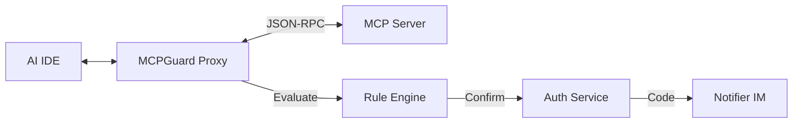

# MCPGuard
<div align="center">
  
  <h3>MCP Safety Authorization Gateway</h3>
</div>

[](https://goreportcard.com/report/github.com/xielforever/MCPGuard)
[](https://opensource.org/licenses/MIT)

## Description

MCPGuard is a Model Context Protocol (MCP) Safety Authorization Gateway written in Go. It acts as a transparent proxy between AI IDEs and MCP Servers, intercepting dangerous operations and requiring confirmation codes before allowing execution.

[中文文档](#) (Chinese translation)

## Features
- **Transparent Proxy**: Intercepts MCP JSON-RPC messages.
- **Rule Engine**: Pattern matching for dangerous tools and operations.
- **Out-of-Band Confirmation**: Requires 2FA via IM (Feishu, Telegram, Slack).
- **Audit Logs**: Records all tool calls and their results.
- **Web UI**: Dashboard for configuration and log viewing.

## Architecture



## Quick Start

1. Build the binary:
   ```bash
   make build
   ```
2. Configure `configs/mcpguard.yaml`.
3. Run:
   ```bash
   ./bin/mcpguard --config configs/mcpguard.yaml
   ```

## Usage Example in IDE (Cursor/Claude)

Instead of running the actual server, point the IDE to MCPGuard:
`mcpguard --config /path/to/mcpguard.yaml`

## Contributing
Pull requests are welcome!

## License
MIT License
