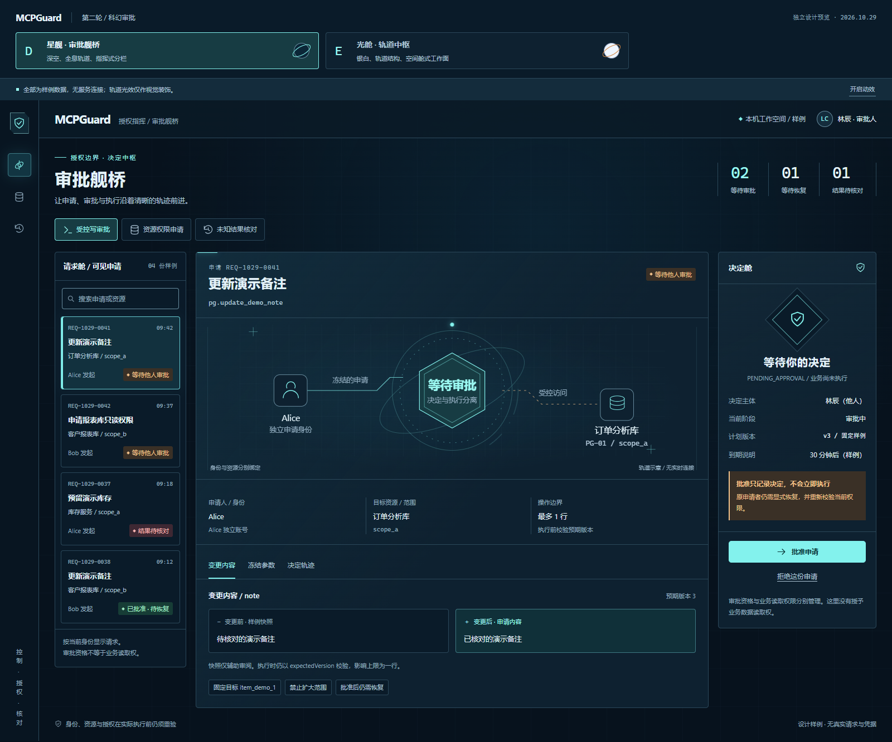

# 执契 UI/UX 设计规范 v1.0

执契的产品标志为**白文篆印**。控制台页眉、登录区域、页脚和浏览器图标使用同一份[透明方印](../../internal/uitheme/brand/zhiqi-seal-mark.png)，OAuth 测试授权页与 Vue 原型也引用该资源。项目介绍使用[方印与碑刻字标的横版组合](brand/zhiqi-seal-concept.png)。

**2026-10-29 实施更新：**D 规范已接入网关内嵌控制台，现有六页使用同一套生成主题与共用组件。当前实现、兼容边界和本地验证以[六页迁移记录](implementation-console-d.md)为准。下文关于“本次交付不修改运行页面”的内容记录规范建立时的交付范围，保留其历史时点；用户最终视觉验收、实际 coding 客户端与生产验收分别进行。

版本：1.0.0。建立日期：2026-10-29。视觉方向：**D「星舰 · 审批舰桥」**。

用户已明确选择“采用设计D，开始出UIUX设计规范”。本规范据此建立项目统一设计基线。方向选择已确认；具体组件与流程由本规范明确，页面迁移、真实接口联调和用户最终验收尚未发生。本次交付不修改运行页面、后端接口、凭据或权限。

## 1 适用范围与权威入口

规范适用于当前网关内嵌控制台，以及后续多资源、账号权限、凭据与吊销管理页面。`web/` 下 Vue 历史原型如继续维护，沿用同一视觉规范，但必须保留其演示身份，不能替代真实控制台或声称已接入真实业务。

| 资料 | 职责与使用方式 |
| --- | --- |
| 本文 `MASTER.md` | 全局视觉、布局、语言与交互原则；所有页面默认遵循 |
| [tokens.json](tokens.json) | 颜色、字号、间距、尺寸、动效等**数值单源**；通过生成器输出运行主题，已接入内嵌控制台现有六页 |
| [components.md](components.md) | 共用组件的变体、状态、行为与可访问性 |
| [workflows.md](workflows.md) | 身份、审批、账号开通、私有交付、激活、执行与撤销的跨页规则 |
| [state-labels.json](state-labels.json) | 按对象区分的状态文案映射，来源绑定当前机器契约；不定义新状态或迁移 |
| [审批页](pages/approvals.md) | 请求舱、轨道、变更审阅与决定舱 |
| [资源与凭据页](pages/resources-and-credentials.md) | 多资源、账号权限申请、客户端与凭据生命周期 |
| [管理页面](pages/management.md) | 登录、导航、规则、用户组、审计与通知设置 |
| [验收与迁移](acceptance.md) | 后续实现的检查清单、依赖、缺口与验收层次 |
| [变更记录](CHANGELOG.md) | 用户选型、规范版本及兼容性变化 |
| [当前六页实现](implementation-console-d.md) | 主题/组件接入、功能保留、验证证据与后续边界 |

安全规则、业务状态及 API 字段以当前[机器契约](../../internal/contracts/v02/source.json)、[受控操作契约](../../internal/gateway/controlled-action.schema.json)、[控制台工作流](../../docs/detailed/console-workflows.md)和已批准的业务设计为准。本规范规定怎样呈现这些事实，不能创建较宽松的授权路径。设计图和示例数据不构成契约。

页面补充规范可以调整信息密度和分区，不得另起主色、字号体系、身份规则或审批语义。确需改变全局规则时，更新本规范版本并说明迁移影响。

## 2 视觉方向：有科幻表达的工作界面

### 2.1 识别特征

1. 深空蓝构成稳定工作背景，面板以更亮的蓝灰区分层级。
2. 青色用于当前选择、主要操作、授权轨道和有限的边缘光；正文保持清晰，不给整段文字加霓虹。
3. 轨道、几何闸门、细网格和局部切角表达资源关系与操作边界。业务名称仍使用“资源、申请、账号、权限、审计”等熟悉词汇。
4. 请求列表、事实审阅、审批决定分区清楚。先看清目标与变化，再作出决定。
5. 装饰动效低频、可关闭，不模拟真实网络、风险评分或执行进度。

正式页面默认采用 D 深色主题。A/B/C/E 作为候选历史保留，不作为正式页面的主题切换选项。后续如增加浅色主题，应单独完成 token、语义及可访问性适配。

### 2.2 已选方向与历史参考

上述图片是选型参考，其中时间、人数、请求和状态均为样例；不作为真实服务的证据。原[交互预览](proposals/2026-10-29-sci-fi/preview-offline.html)保留 D/E 切换与样例身份按钮，**正式产品不得保留“切换为 Alice/审批人”的演示身份开关**。

本规范对预览中的零散尺寸做统一收敛：正文与辅助标签提升到可读字号、列间距归入 4px/8px 节奏、控件统一尺寸、窄屏优先展示决策事实。风格与结构保持 D，不要求照抄每个样例像素。

### 2.3 需要避免的表达

- 全屏发光文字、持续闪烁、故障抖动、自动滚动日志、装饰性实时数字与没有来源的“风险分”。
- 玻璃模糊覆盖正文、为所有面板增加强阴影、把切角施加到可交互控件上裁掉焦点。
- 将密码、凭据包内容或认证头包装成“技术详情”展示；允许复制原始认证错误或原始请求头。
- 依靠绿色按钮、轨道连通或 HTTP 成功码表示业务已经生效。
- 用“能量舱”等隐喻替代资源账号、访问范围、决定影响等关键业务词。

## 3 颜色、字形与视觉尺度

### 3.1 颜色角色

下表列出 v1.0 的核心数值，后续改动以 `tokens.json` 为数值单源，并同步本文说明。

| 语义角色 | 色值 | 用途 |
| --- | --- | --- |
| 工作背景 `bg` | `#07121d` | 深空背景；网格与辉光只作低对比装饰 |
| 面板 `surface` | `#0e2130` | 请求、详情和决定工作面 |
| 提升层 `surfaceRaised` | `#142c3c` | 悬停、次层信息、禁用控件底色 |
| 输入/代码底 `field` | `#0a1b29` | 表单、冻结参数、只读内容 |
| 正文 `text` | `#e4f3fa` | 主要内容和关键目标 |
| 次级文字 `textSecondary` | `#afc6d7` | 描述、字段值的辅助说明 |
| 辅助文字 `textMuted` | `#91acbf` | 标签、版本、时间；不能透明到不可读 |
| 装饰分隔 `separator` | `#2b485a` | 非交互分区；不能作为输入框唯一边界 |
| 控件边界 `controlBorder` | `#688d9f` | 输入、默认按钮及可交互区域的可辨识边界 |
| 主操作 `primary` / 其文字 `onPrimary` | `#83f2ed` / `#073133` | 批准、提交等当前主要操作 |
| 链接 `link` / 选中底 `selected` | `#9bf9f2` / `#173c43` | 可点击链接、当前选中项 |
| 焦点 `focus` | `#b9fff9` | 3px 可见焦点，4px 外偏移 |
| 成功 `success` / 底色 | `#a1ecc5` / `#173d36` | 已确认的对应事实，例如租约有效；不跨对象解释为执行成功 |
| 待办 `warning` / 底色 | `#f1c18a` / `#3a3026` | 待审批、待核对、期限提示 |
| 异常 `danger` / 底色 | `#ffb5b2` / `#3e2833` | 拒绝、撤销、未知影响和错误 |

状态必须同时有文案与图标/结构，不能只靠颜色。`APPROVED` 和业务 `READY` 使用“已批准/已就绪，仍待后续”的语义，不统一画成“执行成功”。无来源、未知枚举或读取失败用“状态未确认”，停止相关变更操作。

文字目标对比度至少 4.5:1；控件关键边界与焦点至少 3:1。装饰线可以更淡，但不能承担控件或关键状态的唯一识别责任。数值检查只证明所列颜色配对，不等于完整可访问性认证。

### 3.2 字体与字号

中文与普通文本使用系统无衬线字体栈：`Segoe UI, PingFang SC, Microsoft YaHei, sans-serif`。标识、版本、工具名与代码使用 `Cascadia Code, SFMono-Regular, Consolas, monospace`。不强制联网加载字体。

| 角色 | 字号 / 行高 | 字重 | 应用 |
| --- | --- | --- | --- |
| 页面标题 | 32 / 42px | 600 | 审批舰桥、资源目录 |
| 分区标题 | 24 / 34px | 600 | 当前申请标题 |
| 组标题 | 18 / 28px | 600 | 变更计划、申请范围 |
| 组件标题 | 16 / 24px | 600 | 请求队列、决定区 |
| 正文 | 14 / 22px | 400 | 描述、业务内容 |
| 表格 | 13 / 22px | 400 | 资源、权限、审计列表 |
| 标签 / 代码 | 12 / 20px | 500 / 400 | 时间、状态、短标识、冻结参数 |
| 计数 | 28 / 36px | 500 | 有当前来源的分类计数 |

业务文字最小 12px；手机输入框文字为 16px。标题不超过 1px 字距，正文不人为拉宽字距。中文正文不全部使用等宽字体，编号使用等宽数字。长 ID 可换行或中部省略并提供完整安全值与复制操作，不裁掉关键目标。

### 3.3 间距、形状与图标

- 使用 4px 基础、8px 主节奏：4/8/12/16/20/24/28/32/40/48px。
- 页边距桌面 24px、手机 16px；分区间距 24px，列间距 16px。
- 标签圆角 3px，控件 5px，面板 6px，确认框 8px。几何切角用于面板装饰，不能裁剪输入、按钮、滚动条或焦点。
- 面板默认无投影；主选中边缘可用 `0 0 22px rgb(77 221 234 / 14%)`。大面积正文面板不发光。
- 图标使用统一线性 SVG，默认 20px、线宽 1.5px，小图标 16px、大图标 24px。延续当前 Element Plus 图标或同一受控 SVG 集，不为两种前端分别引入视觉语言。
- 图标只作辅助时隐藏于辅助技术；单独图标按钮必须有可访问名称与状态说明。禁止用 emoji 作为结构图标。

## 4 全局布局与响应式

### 4.1 应用外壳

桌面保留 D 的紧凑导航轨道，标准宽 72px；提供清晰的展开入口，展开宽 208px。图标轨道必须支持鼠标与键盘提示，当前页面名称持续出现在页头。导航项来自当前可信权限与能力，不能通过隐藏菜单代替鉴权。

顶部栏高 68px，持续展示执契、当前组织/工作空间、当前人员与必要的身份状态。页面内容最大宽 1920px，在超宽屏居中；长段正文保持适宜行长，不把参数说明拉满整个屏幕。

逻辑导航包括：操作与审批、资源目录、我的账号权限、凭据与客户端、策略规则、用户与权限、本人审计、通知与设置。现有六个页面可以分组承载新增内容；逻辑名称不等于本次新增路由或已开放功能。

### 4.2 审批三栏

桌面有足够空间时：请求队列 240px，审阅面板至少 560px，决定区 288px，列间隔 16px。轨道位于审阅区中，用于帮助理解身份与目标；完整目标、作用域、参数和权限仍以文字展示。

| 视口 | 布局规则 |
| --- | --- |
| ≥1600px | 保持三栏，可适度增加中央审阅区；不放大装饰来填满空白 |
| 1280–1599px | 标准三栏；若展开导航或 200% 缩放后空间不足，降为双栏 |
| 1024–1279px | 请求队列与审阅双栏，决定区接在审阅内容之后 |
| 768–1023px | 队列可折叠；优先给完整审阅与决定内容留空间 |
| 640–767px | 单列内容，队列改为可折叠列表或有明确滚动提示的横向列表 |
| ≤639px | 顶部菜单、单列审阅；先给出当前申请/目标/阶段，再展开参数和决定 |

断点之外还须按可用空间降级，不能仅因视口大于 1280px 就强制挤入三栏。CSS Grid 子项必须允许收缩；宽表格只在带名称的局部区域滚动，页面本身不产生横向溢出。

手机可提供“查看决定区”锚点；底部固定操作区只有在关键目标和变更仍可查看、给正文预留空间且不遮挡焦点时才使用。审批主按钮触控高度至少 44px，主要按钮建议 48px。不能让长队列阻挡当前选中申请的关键内容。

## 5 组件与交互的一致性

共用组件采用 [components.md](components.md) 的规格。页面不能各自重写按钮颜色、状态颜色、输入高度和确认框行为。

每个独立决策区域只设置一个主操作。审批可用青色批准按钮，拒绝作为明确的次级决定保留足够点击区域；拒绝/吊销确认框内，以对应的危险操作作为主动作，不沿用“批准”的正向文案。

按钮、表单、状态、加载、空状态、错误、表格、详情标签、差异对照、确认框和通知均覆盖默认、悬停、焦点、禁用、提交中及失败状态。所有失败必须区分“未提交”“提交结果未确认”和“服务端明确拒绝”。

界面不因按钮变色就修改权威业务状态，不提供前端模拟成功、默认假计数或临时管理员切换。刷新与查看详情是读取动作，不能偷偷执行批准、领取、开通或恢复写入。

## 6 状态、身份与信息边界

### 6.1 按对象显示事实

申请决定、AccessGrant、开通任务、文件租约、领取 ticket、客户端 Context、资源激活、业务执行、在途停止与原生清理分别展示。对象的 `ACTIVE` 不共用一个“全部正常”灯；完整映射见 [state-labels.json](state-labels.json)。

`CLAIMED` 只能证明领取资格已消费，不能证明文件完整到达客户端；“文件存在”不能证明授权有效；`READY` 不能表示后端已经执行；“已撤销授权”不能表示原生账号已经清理或在途操作已停止。

### 6.2 身份与隐私

主体来自服务端认证上下文。正式页面不能通过修改姓名、选择申请人、别名、URL 或前端角色开关切换成其他用户。切换已认证账号或组织后，立即清空旧页面的申请、结果、选择、游标和敏感草稿，再取新范围数据。

审批资格不授予业务数据读取权。需要足够细节才能决定；无权取得必要细节时禁用决定并说明原因，不设置“参数已隐藏，仍可批准”。

普通页面只展示经当前主体授权的安全元数据。不得展示、复制或写入普通日志：数据库密码、DSN、SecretRef、解密密钥、员工 token、Context token、私有交付证明、认证头、密文包内容和可免认证领取链接。服务端解密与原生连接边界保持不变。

### 6.3 当前能力与目标设计

当前 RA-01 至 RA-10 的本地实现记录支持目录、申请/决定、开通恢复、加密引用包、私有交付、Context 与适配器基础；它们不等于新页面已接线、生产已部署或真实 coding 产品已验收。完整多资源界面仍属后续 RA-16；正式新资源执行与全面吊销分别依赖后续阶段。

不支持的功能应显示明确的未开放/不支持原因，或不出现操作入口；不能用占位按钮返回“成功”。样例只能存在于清晰标注的设计预览或开发夹具，不进入正式业务页面。

## 7 动效与反馈

普通反馈 160ms，进入 200ms，退出 120ms。轨道装饰一周 78 秒；每个视图最多一个环境动效和一个有限状态过渡，不能给每个状态标签和数据行持续动画。

支持“关闭动效”，后台页面暂停；`prefers-reduced-motion: reduce` 优先取消非必要动画、位移和旋转。暂停不改变业务状态。重新布局只调整必要区域，不重建整份审批 DOM，不丢失焦点或已输入理由。

轨道装饰、等待 spinner 和连接线不表示真实派发或实时连通。执行进度只有在后端存在可靠分阶段证据时才展示；没有总量时用明确文字和不定进度，不伪造百分比、实时流量或风险指数。

## 8 文案与可访问性

中文为默认界面语言；保留 API、PG、Redis、JSON、SQL、工具名、ID 和必要状态码。科幻表达用于品牌和分区，不能让用户猜“批准会不会执行”。

推荐固定文案：

- “请求已提交，尚未执行；等待合格他人审批。”
- “已批准，等待原申请者显式恢复。”
- “授权已开通；尚未完成客户端私有领取与激活。”
- “领取资格已消费，客户端接收结果待核对。”
- “结果未知 · 请勿重复提交。”
- “网关授权已撤销；在途停止与原生清理见各自状态。”

使用真实标题层级、原生按钮和表单标签。完整流程支持键盘；详情标签用方向键/Home/End，确认框限制焦点、支持 Escape，关闭后回到仍存在且可见的触发控件。触发控件失效时回到当前对象标题或安全列表，不回到旧身份内容。

网页点击区域最小 24×24px，桌面常规目标 40px，触控目标至少 44px。200% 缩放、窄屏和减少动画不丢失核心内容与操作。任何状态不只用颜色，错误同时有文字并关联字段。

## 9 后续实现与维护

正式实现从 `tokens.json` 生成或导入同一份语义主题，再分别桥接内嵌页面和 Element Plus；不在两套前端手抄两份调色板。页面不得新增无语义的 `blue/red` 类代替状态对象。

正式 CSS 变量统一用 `--mg-` 前缀，语义路径转为可读名称；同一变量只能由统一主题源产生。以下是实施命名约定，不是本轮已创建的运行 CSS：

| 设计数据路径 | 后续变量示例 |
| --- | --- |
| `semantic.color.primary` | `--mg-color-primary` |
| `semantic.color.onPrimary` | `--mg-color-on-primary` |
| `semantic.color.surfaceRaised` | `--mg-color-surface-raised` |
| `primitives.space.4` | `--mg-space-4` |
| `typography.scale.body.size` | `--mg-font-size-body` |
| `components.button.heightMd` | `--mg-button-height-md` |

框架桥接必须同时覆盖主按钮文字、所有状态、输入、菜单与根部浮层；D 的浅青色主按钮不能保留默认白字。正式页面不直接导入候选预览的 CSS/JS，避免带入演示身份、假数据与 D/E 选型控件。

本次不创建运行 CSS、不改 Vue/Go 业务文件、不升级依赖、不修改机器契约或历史报告。后续每个页面迁移都应交付真实接口、权限、状态、键盘与截图验证，按 [acceptance.md](acceptance.md) 区分规范检查、技术通过与用户验收。

规范可继续细化，但不能以未提出的新审批门槛阻止已获准实施。改变视觉主方向、扩展业务权限或引入新接口属于新的范围决定，应清楚记录；普通组件落地按已选 D 和现有业务授权继续执行。
