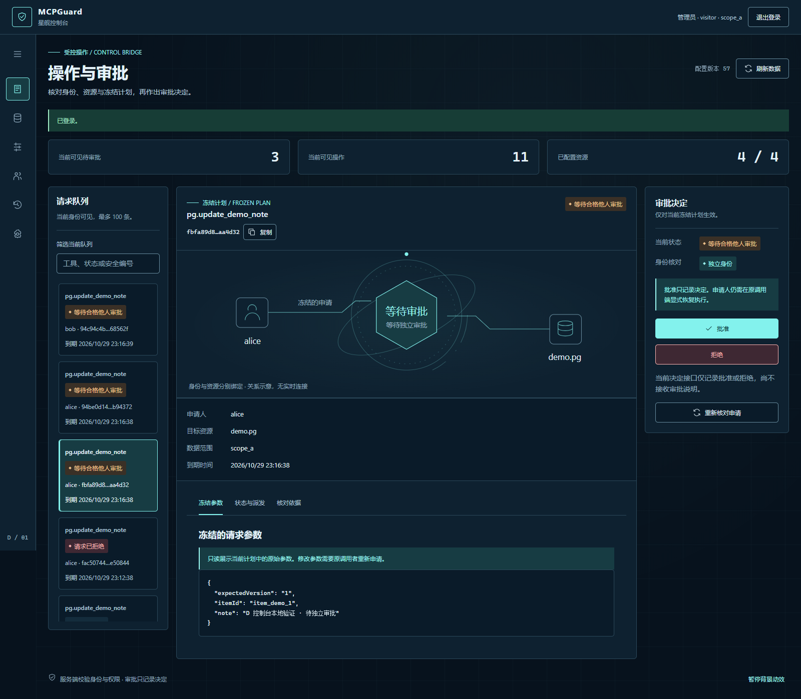

# D 控制台 · 本地桌面验证

日期：2026-10-29。结果：**PASS_LOCAL_DESKTOP**。范围为网关内嵌控制台现有六页；按用户后续要求，最终专项复核只考虑桌面。

本次在新建的隔离夹具 `9ca173a91c` 验证真实浏览器会话、真实管理 API 和独立 PostgreSQL/Redis 数据。原本四个本机服务的镜像与启动指纹保持一致。本记录不等于用户最终视觉验收、实际 coding 客户端或生产验收。

## 1 验证结果

| 检查 | 结果与证据 |
| --- | --- |
| Go race 全量回归 | **294 项通过，0 跳过，0 失败**；[安全摘要](go-tests.summary.json)，原始 JSONL 留在本次 Linux 私有场景 |
| HTTP/stdio 协议回归 | **56 项通过**；[摘要](http-stdio.summary.json)，独立脚本不是桌面原生 MCP 验收 |
| 浏览器/API 功能回归 | **85 项通过**；[完整记录](functional-before-desktop-scope/report.json)，含用户收敛桌面范围前已产生的辅助检查，按历史保留 |
| 最终桌面专项 | **60 项通过**；[完整记录](desktop/report.json)，四种桌面宽度、六页、导航展开/收起、阅读宽度与焦点 |
| 主题/源码保留 | **311 项通过**；[检查记录](source-checks.json)，126 个原有方案/验证文件保持原字节 |
| 生成器、语法与静态检查 | `generate_ui_theme.py --check`、Node 语法、Python 编译、`go vet ./...` 通过 |
| 原服务保留 | [前后指纹](live-services.json)一致；未替换原网关镜像 |

汇总为 [report.json](report.json)，最终实现来源为 [source-manifest.json](source-manifest.json)。测试总数分别来自各自检查范围，不相加为一个端到端验收数字。

## 2 真实功能证明

- 独立浏览器登录保留 Host、Origin、Cookie 会话、CSRF 与当前身份校验。普通用户无法读取管理员快照、管理表单或他人越权请求；本人申请没有自批控制。
- 审批先确认冻结对象并重新读取资格。批准只记录 `READY`，执行编号仍为空、派发仍未开始；拒绝真实记录 `DENIED`，同样不创建原生执行。
- 资源启停、规则新增/启停、身份业务权限、直接工具/审批/管理授权、用户组创建/启停及组成员/工具/审批授权均通过原真实 API 持久保存。脚本读取服务端快照核对保存结果。
- 无效表达式和配置版本冲突保留表单草稿；冲突不会自动换版本或生成新命令再提交。脚本验证缺少 CSRF、错误 Origin 和失去审批资格时服务端仍拒绝。
- 网络故障用例让服务端先真实提交，再中断第一次浏览器响应；页面保持“响应未确认”。手动重试复用相同 body/版本/幂等编号，服务端配置版本没有第二次增长。
- 详情响应乱序、旧身份状态响应迟到、退出/401、本人审计游标切换均不会恢复旧身份内容。规则表达式和组名中的 HTML/脚本标记仅作普通文本显示。
- 结果未知、派发未知、副作用未知及过期显示采用明确的浏览器响应注入用例；即使注入旧 `canReview=true` 也不开放决定。这证明展示与前端门控，不冒充真实原生崩溃或数据库未知结果证明。

## 3 桌面视觉证据

最终复核覆盖 **1920、1600、1440、1280px**，每种宽度测试六页及导航展开/收起。1280px 展开导航时，决定区移至审阅下方，保证审阅区不少于 560px。全页没有横向溢出，表格使用自身命名滚动区。

| 页面 | 最终桌面截图 |
| --- | --- |
| 操作与审批 | [1600px](desktop/desktop-0.png)、[1280px 收起导航](desktop/review-1280-compact.png)、[1280px 展开导航](desktop/review-1280-expanded.png) |
| 资源 | [桌面截图](desktop/desktop-1.png) |
| 规则 | [桌面截图](desktop/desktop-2.png) |
| 用户与权限 | [桌面截图](desktop/desktop-3.png) |
| 本人审计 | [桌面截图](desktop/desktop-4.png) |
| 通知与设置 | [桌面截图](desktop/desktop-5.png) |

以下为真实隔离申请处于待审批阶段时的功能回归截图，使用本次合成测试身份与数据：

审批确认框及批准后的真实状态分别见[确认框](functional-before-desktop-scope/approval-confirmation.png)和[READY 状态](functional-before-desktop-scope/approval-ready.png)。前一轮已产生的窄屏记录保留在其原检查集合中；用户明确取消移动端考虑后未继续扩展移动端工作，也不把它列为最终交付目标。

## 4 保留的失败与修正

1. 最早的静态资源检查用一个页面未使用的 CSS 变量作为 marker，错误报告资源不匹配。资源本身存在；marker 改为实际使用的共用 separator token 后复核通过。原工具输出没有被改写成通过。
2. 第一轮浏览器运行在身份下拉框处失败，发现隐式 label 的名称包含选项文字。共用组件改为给标签文字独立 ID，并通过 `aria-labelledby` 绑定控件；其后所有权限表单通过真实保存验证。原[失败记录](failed-runs/2026-10-29T14-52-01-139Z.json)保留。
3. 第二轮在末尾检查失败。只读诊断证明 Playwright 截图后会在登录输入保留空 `style=""` 属性，未包含 CSS 声明。检查改为拒绝实际内联脚本、样式声明和事件处理器，源码仍单独禁止这些写法；未放宽 CSP。[该次失败](failed-runs/2026-10-29T14-57-30-542Z.json)与通过记录分别保留。

失败运行的截图和原始日志继续留在 `.dev/console-d-ui-2026-10-29/runs/`；公共报告只提取无凭据的结果与必要截图。所有旧 RA 报告、设计候选和之前的规范检查报告均未修改。

## 5 交付边界

- UI/UX 基线数值仍为 1.0.0，token 集成状态已更新，旧 token 文件保留在迁移前快照。
- 后端业务逻辑与原 API/契约/迁移保持原状。旧受控写决定仅接收 `vote/planHash`，页面未添加假理由字段。
- 新资源生命周期的完整管理页面仍按 RA-16 等后续计划实施，不属于本次现有六页迁移。
- 本轮不提交、不推送、不替换原本机网关镜像。新隔离预览与私有测试场景保留；最终视觉与交互偏好仍由用户验收。
