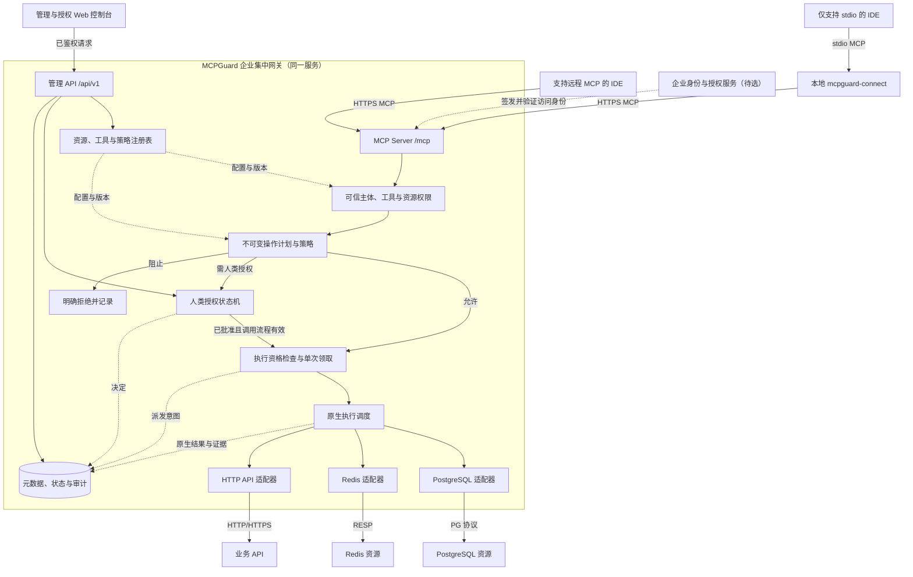
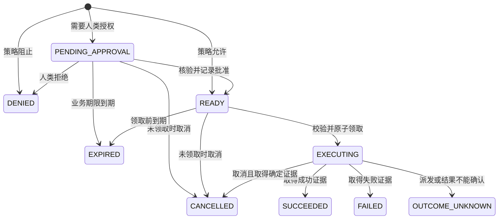

# MCPGuard 系统总体设计 v0.1

状态：设计初稿，待评审；不是已实现能力清单。日期：2026-10-22。源码基线：ad0a685cf39e48cf4abe72a6d8b6f0a8f0e89bac。

MCPGuard 是企业集中 MCP 网关。IDE 通过 MCP 调用网关提供的工具，网关统一完成员工身份、资源权限、策略、人类授权、原生执行与审计。**MCP Server 与企业网关是同一个服务；后端服务使用各自原生协议。**

需求状态和验收编号见[产品需求](requirements.md)；领域、输入输出和管理接口见[调用契约](contracts.md)。本文负责解释系统如何组成、调用如何流转及哪些约束必须同时成立。可实施的模块、DDL、策略、连接器与故障方案见[详细设计](detailed/README.md)。

## 1 设计边界

| 事项 | 状态 | 本稿约束 |
|---|---|---|
| 产品形态 | 已确认 | 企业集中部署，服务多员工、多资源 |
| IDE 远程接入 | 已确认 | 支持 HTTP/HTTPS MCP 直接连接中央网关 |
| IDE stdio 接入 | 已确认 | 提供本地 stdio 转 HTTP 程序，连接同一个中央网关 |
| 后端协议 | 已确认 | PG 使用 PostgreSQL 协议，Redis 使用 RESP，业务 API 使用 HTTP/HTTPS |
| 资源位置与连通 | 已确认 | 企业服务器与员工本地混合，物理互通已具备 |
| 服务划分 | 建议 | 模块化 Go 服务、持久状态库、Web 控制台与本地接入程序 |
| 工具开放形态 | 已确认 | 受控PG模板、限定Redis命令/key、固定API operation；具体名单与权限继续细化 |
| 人类授权规则 | 已确认 | 风险分级：授权普通读自动、受控写由他人审批、高危默认禁止 |
| 身份与审批平台 | 待定 | 企业IdP、审批组、路由、通知渠道及保留参数 |
| 客户端支持范围 | 部分确认 | ChatGPT首发HTTP接入；账号/工作区、profile和实际能力仍需验证 |

HTTP 与 stdio 两条路径可以先后开发，但均属于产品目标，各自需要验收。后端无须实现 MCP，也不设置下游 MCP Client 或 MCP 工具聚合服务。

## 2 系统架构

下图是拟议逻辑组件，不表示实现完成或必须拆分为多个进程。

两类 IDE 最终进入同一个 MCP Server 和业务处理器。网关根据计划选择原生适配器。Web 控制台使用独立管理 API，读取和修改网关持久状态；企业身份源负责可信身份，网关的人类授权状态机负责认定具体操作是否获批。

| 组件 | 职责与边界 |
|---|---|
| mcpguard-connect | stdio/HTTP 传输适配、员工登录、令牌保管、流与取消映射；不拥有资源凭据或审批权 |
| MCP Server | 协议版本、能力、认证上下文、工具发现与调用、进度、取消和结果编码 |
| 资源与工具注册表 | 管理资源、凭据引用、工具 Schema、原生 operation、版本和访问范围 |
| 权限与策略 | 逐次检查主体、目标、操作与数据范围，输出允许、阻止或需人类授权 |
| 计划与授权 | 固定真实操作，展示受保护详情，核验决策人资格，持久保存决定及期限 |
| 执行调度与适配器 | 领取执行资格、解析受控凭据、管理原生连接与事务、记录结果和副作用证据 |
| 管理 API 与控制台 | 资源/工具/策略管理、我的请求、待处理授权、执行与审计检索 |
| 状态库与凭据提供方 | 持久业务状态、版本与审计；凭据托管机制待选，业务记录只保存引用及必要版本 |

网关自身的元数据数据库与被纳管的业务 PG 是不同用途的资源，凭据和权限分别管理。本轮工程设计选用PostgreSQL权威状态库保证授权、执行领取与事件记录的一致性；部署副本与留存参数仍待评估。

## 3 资源、工具与身份模型

资源表示一个可管理服务，至少包含类型、地址配置、归属、访问范围、配置版本及凭据引用。资源在员工电脑还是企业服务器，不改变其原生类型，也不从“可连接”自动推导员工权限。

工具是网关向 IDE 发布的能力，定义名称、输入输出 Schema、资源绑定、适配器 operation、操作语义、策略和限制。例如 redis.get_demo_note 绑定固定 Redis 资源；directory.get_demo_office 绑定已登记 HTTP operation。工具名在本文中均为示例，完整字段和调用示例见[调用契约](contracts.md)。

工具可绑定固定资源或受控资源集合。客户端提交 resource ID 时仍需查注册表、检查归属和操作范围；不能提交任意连接串、URL、认证头或执行身份。工具目录按权限过滤，调用时再次检查，不以目录缓存作为授权证据。

员工访问身份与后端执行身份分别记录。前者由经验证的网关 access token 建立；后者为指定 PG 角色、Redis ACL 用户或 API 身份。可采用经验证的用户委托映射，或按资源与操作隔离的最小权限服务身份，具体映射待定。

连接池按资源、实际后端身份、凭据版本与配置隔离。共享服务账号可复用连接，但员工的权限、Action 与审计上下文独立；事务、会话状态、未读响应和旧凭据不能泄漏到后续调用。

## 4 一次调用如何完成

1. 员工通过 HTTP 直连或 stdio 接入程序连接 /mcp，网关验证面向本资源的访问令牌并构造 Principal。
2. tools/list 生成该主体可见目录；tools/call 再次检查 Schema、工具版本、目标和当次权限。
3. 建立 Action 与本次 Attempt，解析资源配置、执行身份和完整业务参数，生成不可变 OperationPlan，再评估策略。
4. 阻止则终止并记录；允许则取得策略授权；需要人类授权则进入等待，可信决策绑定该计划。
5. 按所选调用交互继续，执行前检查有效期、撤权、配置与前置条件，通过原子条件更新领取派发资格并持久记录意图。
6. 适配器使用计划中的 PG 模板、Redis 命令或 HTTP operation，执行原生操作，记录原生证据。
7. 持久化请求结果与已知副作用状态，按 MCP profile 返回工具结果；控制台可查询关联记录。

等待人类期间不占用业务事务、锁或专属连接。预览必须无副作用且标明时点，不能把预览数量当成执行保证；必要前置条件在短执行窗口内重检。

## 5 操作计划与人类授权

计划固定调用者、工具及版本、目标资源及配置版本、后端执行身份、凭据版本、完整业务操作和参数、策略版本、限制、前置条件及期限。计划摘要绑定规范化内容，完整参数受保护保存，审批摘要与最终执行不得指向不同操作。

已确定按风险分级：授权普通读取自动放行，受控写由他人审批，高危操作默认禁止。网关核验真实决策身份与资格并持久记录，以稳定主体ID强制操作人与审批人不同。ChatGPT自身确认不能替代此决定；普通批准不能覆盖明确禁止或补足资源权限。

通知只用于送达，审批页或可信回调完成验证后才产生决定。模型提交 approved=true、客户端 accept、IM 文本或浏览器跳转成功均不能证明已获批准。

调用交互与业务授权分开：

- 普通调用可有界等待，窗口以实测确定；最终返回后不再向同一 RPC 补发结果。
- MRTR 在对应 profile 与客户端支持时关联后续新 RPC；回调只更新决定，有效续传再领取执行权。
- CONTROL_FLOW 在创建时明确选择，最终返回未执行的 DeferredActionResult，后续通过 action.status/resume/cancel 交互；不向旧 RPC 补发结果。Tasks 不作为首版依赖。
- 普通等待结束且尚未派发时终止该执行路径，迟到批准不自动启动写操作。

具体协议、发现和取消规则见[MCP 接入设计](mcp-protocol-design.md)与[IDE 兼容方案](ide-access-compatibility.md)。

## 6 状态与执行不变量

Action 表示一个业务意图；Attempt 表示一次 MCP 请求；Execution 表示一次执行领取及派发跟踪，记录存在不证明已发送，未领取时不创建。MRTR 的新 RPC ID 可关联同一 Action，但不能因此获得第二次派发资格。

以下状态与详细存储模型一致。计划构建与策略评估完成后持久创建 Action；策略允许或合格人类批准进入 READY，授权来源与决定另外记录。

策略自动允许记录授权来源 POLICY，人类批准记录 HUMAN 及可信决定；不能仅从 READY 推断有人批准。DENIED 的原因区分策略阻止与人类拒绝。状态推进及必要审计使用本地事务；事务不跨等待人类或远端服务。

| 不变量 | 对应行为 |
|---|---|
| 授权绑定完整计划 | 参数、目标、身份或影响授权的版本变化时拒绝或重新计划授权 |
| 执行前可终止 | 未派发的过期、撤权、取消及无效批准不能获得执行权 |
| 同一资格只消费一次 | 重复回调、MRTR 续传、任务重投、并发领取和进程重启不能重复派发 |
| 派发事实据实表达 | 已登记意图不等于后端已收到；崩溃留下无法判定的窗口时记录未知 |
| 请求结果与副作用分离 | FAILED/CANCELLED/isError 不等于未生效；可同时记录部分生效或未知 |
| 取消尽力处理 | 按 profile 与适配器取消，不能承诺撤销已提交的后端操作 |
| 不盲重试未知写入 | 先查询可靠业务状态或人工核对，不能仅凭超时、断线或输出校验失败重发 |

一次网关派发资格不保证外部服务端到端恰好一次。适配器关闭可能重放写入的隐式重试、重定向及连接恢复行为；需要恢复时依赖具体操作已验证的幂等契约和证据，作为显式设计。

## 7 原生执行边界

| 适配器 | 首版建议 | 必须遵守的限制 |
|---|---|---|
| PostgreSQL | 审核后的参数化读写模板及结构读取 | 最小权限角色；不能仅凭 SELECT 前缀判断只读；短事务；提交响应丢失可能结果未知 |
| Redis | 受控 GET/MGET、有界枚举与已注册写操作 | ACL 加适配器检查全部 key、命令与选项；脚本或事务错误不保证回滚 |
| HTTP API | 注册服务与明确业务 operation | 固定目标、路由、身份与 Schema；方法不单独证明语义；幂等键须由后端真正支持 |

PG 事务只覆盖其自身事务边界；网关不承诺 PG、Redis、API 之间统一回滚。具体连接、数值/二进制编码、结果截断和错误处理见[原生适配设计](native-adapter-design.md)。

后端认证失败作为原生工具执行错误处理，不能把业务 API 的 401/403 冒充员工 MCP OAuth 失效。返回可读摘要与受约束的结构化结果，敏感数据访问与结果检索也需逐次鉴权。

## 8 管理、审计与运行约束

建议职责包括操作人、授权决策人、资源管理员、工具与策略管理员、审计员，允许按企业规则兼任。角色、组或项目范围和数据级权限仍待细化。

最小控制台提供资源与连接状态、工具及版本、策略、我的请求、待处理授权、执行及审计查询。管理 API 与 MCP 入口共用领域规则，分别处理浏览器管理会话和 MCP 访问令牌。

审计关联主体、Action/Attempt/Execution、计划摘要、策略、决策、资源与执行身份、派发及结果。凭据、令牌、授权秘密不进入普通日志；敏感参数通过受控详情访问。写入派发前必须持久保存必要授权及意图证据；无法保存时停止派发。已发生远端效果后的记录失败需可恢复核对，不能改写为未执行。

容量、并发、等待期限、结果大小、审计留存与可用性目标依据场景和实测确定。本稿要求有明确限制及可观测证据，不编造性能数字。

## 9 与现有代码的关系

仓库当前为 Go 1.22、Gin/SQLite 后端与 Vue 控制台脚手架，已有规则、确认和通知概念。原代理将 JSON-RPC 转发给另一个 MCP 进程，不是本设计的原生执行实现；现有页面和早期测试不能证明目标架构已完成。

建议以领域模型和统一调用处理器为重构中心，复用可用页面和基础组件；替换旧下游 MCP 转发路径，接入正式 MCP Server 与原生适配器。官方 Go SDK 及升级建议见[协议设计](mcp-protocol-design.md)，本轮不修改代码或依赖。

## 10 交付与待定决定

[交付计划](delivery-plan.md)按设计基线、两入口与身份、持久策略状态、原生适配、人类授权控制台、故障与真实 IDE 验收分阶段推进，并关联需求验收。

沙箱闭环使用真实网关、两入口客户端、真实测试 PG/Redis、可控 HTTP、模拟身份与通知，全部测试数据可重建，不需要大模型 key。真实 IDE 的模型体验、企业 IdP 和所选通知平台需在相应环境另验，模拟通过不替代真实接入。

风险分级、受控工具形态与ChatGPT首发方向已经确认。下一轮继续细化：

1. 首批工具与访问范围：PG、Redis、API 各开放哪些读取和受控写操作。
2. 他人审批的资格来源、路由、敏感操作分类及通知渠道。
3. ChatGPT账号/工作区、实际MCP能力与身份流程；stdio另选支持该路径的真实客户端验收。

已确认边界发生变化时同步更新需求、契约、适配与验收，不在单篇文档中暗改范围。
