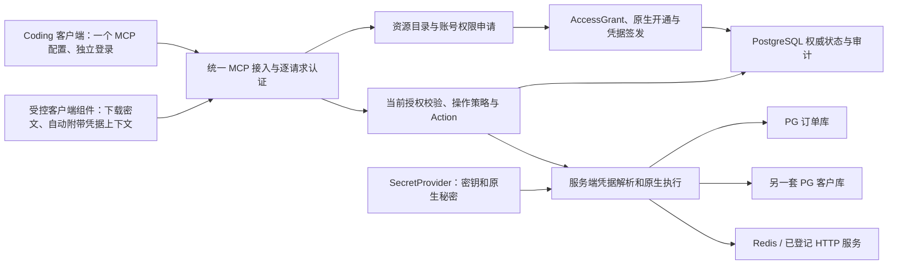
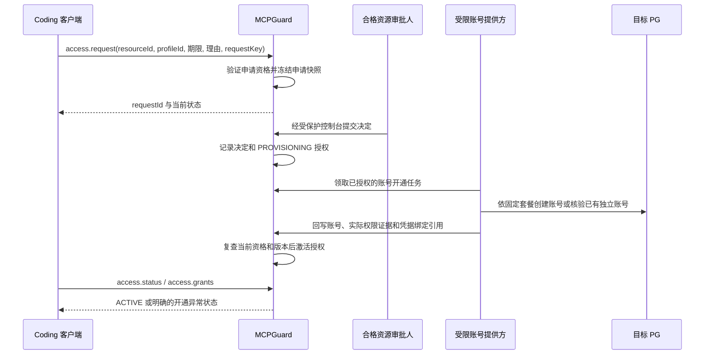

# 多资源架构与完整访问流程

版本：v0.2 设计增量。日期：2026-10-24。实现状态：NOT_STARTED。范围与优先级见 [设计入口](README.md)，字段和接口见 [领域契约](contracts.md)。

## 1 信任边界与模块

| 模块 | 责任与边界 |
|---|---|
| IdentityVerifier | 验证面向 MCPGuard 的员工身份；请求自报的用户名、组和设备名不能授予权限 |
| ResourceCatalog | 版本化端点、TLS、归属、可见性、允许的操作和权限套餐；公开视图不包含秘密 |
| AccessService | 申请、申请决定、授权期限和撤权；与业务 Action 分开 |
| ProvisioningProvider | 根据冻结开通计划建立或核验原生账号、权限与凭据绑定；独立受限管理身份，不使用业务查询角色开账号 |
| CredentialService | 签发密文文件、下载资格、客户端激活、状态与吊销；不对外提供解密结果 |
| ExecutionCoordinator | 检查当前授权和包状态、冻结业务计划、单次领取、在途和结果事实 |
| NativeAdapter / PoolManager | 以计划中的资源和实际原生身份访问后端；池不承载员工持续授权 |
| Console / Audit | 资源维护、申请决定、开通异常、凭据状态及吊销；按权限展示关联记录 |

网关元数据 PG 与每套业务 PG 的连接、角色和权限独立。终端只持密文包和面向网关的认证上下文。服务端原生适配器能够使用秘密，但不得通过业务结果、错误、日志、导出或调试接口将它返回终端。

## 2 多资源和身份解析

一套可授权数据库对应一个稳定 resourceId。类型相同或库名相同不代表同一资源；资源版本绑定主机、端口、数据库、TLS 身份及连接约束。别名是展示信息，不能作为唯一授权键。

一次执行至少关联：已认证的 principalId、resourceId 和配置版本、AccessGrant、CredentialPackage、CredentialBinding、实际原生账号、当前秘密版本及 OperationDefinition。

原生身份默认按主体、资源和权限套餐隔离。Alice 在订单 PG、Bob 在订单 PG、Alice 在另一套 PG 是三条独立绑定。账号字符串相同但位于不同实例时仍不能合并连接池或审计。

权限取交集：当前主体及组资格、资源访问授权、已批准权限套餐、原生账号可强制的权限、工具/操作绑定、本次操作策略和必要的具体批准。申请理由或模型生成的 SQL 不参与推导真实身份。

PG 使用已配置角色、视图、对象权限和必要的 RLS 落实数据范围。两个用户名拥有相同权限时不会自动产生行隔离；表所有者、BYPASSRLS、函数和角色切换能力须核验。现有 demo 的 scope_id 条件仅保留为该演示模板语义，不要求所有纳管数据库实现同一字段。

开通、连接建立和轮换时核对实际权限，按资源配置的新鲜度预算复核外部权限漂移；发现不符则冻结绑定并记录原因。原生管理员在网关外变更权限的传播时效必须实测，不能宣称所有外部变更都会瞬时反映到已有计划。

## 3 资源登记、校验与发布

1. 资源负责人登记停用状态的 Resource，关联受控端点、归属、审批路由、权限套餐和操作绑定。
2. 受限管理接口导入原生管理凭据引用；普通申请人不能提交任意 DSN、认证头或目标 URL。
3. 使用受控无副作用检查核验目标、TLS、数据库身份、连接限制及套餐能否在原生侧落实。检查可达不等于资源已发布或员工已获权。
4. 发布不可变资源配置版本并启用，提交当前 head、授权 epoch 和审计。目标或原生权限语义变化需要新版本，并使旧包及尚未领取计划失效或重新申请。
5. resource.list 只返回调用者可见的安全描述、是否可申请、当前授权与开通状态。只有可申请标记不产生执行权限；直接猜 ID 仍逐次鉴权。

元数据自身及其管理账号不得作为默认业务资源暴露。端点指向元数据存储、凭据服务或未登记管理地址时拒绝纳管。

## 4 申请、决定与原生账号开通

申请快照冻结主体、资源及版本、权限套餐及版本、请求期限、理由和申请摘要。合格他人审批是默认路径；只有经过配置审核的预授权规则才能自动决定指定低风险申请。管理员不能通过模型可调用的批准工具自批。

AccessRequest 的 APPROVED 只表示权限申请已获决定。原生账号开通、真实权限核验和授权激活完成前，AccessGrant 保持 PROVISIONING，不能签发可用包或执行业务调用。

首批 PG 实现支持受限提供方创建按主体/资源/套餐隔离的账号，以及接管已明确登记的独立账号。后者必须核验身份、实际权限和托管边界，不能用全员共享账号冒充个人隔离。未经托管的既有权限不能由清理任务随意删除。

审批回调只保存决定。独立开通 worker 可以自动处理已经获准的冻结账号管理任务，这是本增量的专门流程；它没有业务工具执行权。通知、恢复 worker 和普通 Outbox 消费者不能借此派发业务 SQL。

开通采用预设模板、确定的任务 ID 和可核对的原生账号标识。重复决定、网络断开和并发领取不得创建多份不受管账号。若原生侧可能已经创建账号但回执丢失，置为 PROVISIONING_UNKNOWN，查询既定账号和实际权限后收敛；不能盲目换名重建。撤权先发生时，迟到开通结果只进入清理流程，不能激活授权。

## 5 凭据签发、下载和自动使用

AccessGrant 为 ACTIVE 后，申请人准备下载。网关重新核验授权，创建 CredentialLease 和唯一 CredentialPackage；文件只封装服务端可验证的加密引用，不放入原生密码。受控客户端组件经独立认证接口下载、保存及激活文件，后续模型只选择资源和非秘密 credentialId。

一次配置连接同一 MCPGuard，可维护多个资源的激活绑定。客户端通过独立 CredentialContext 提交密文已领取的证明；服务端仍逐次检查包及授权。具体私有接口、HTTP helper 与 stdio 适配见 [凭据与客户端](credential-lifecycle.md)。

下载成功不是授权激活、数据库连接或业务执行的证明。没有安全下载/激活能力的客户端可以发现资源、申请和查状态，但本增量的执行能力保持未验收，不能静默绕过文件要求。

## 6 服务端读取与受控写

1. 验证当前 MCP access token，得到可信主体；MCP 会话或 CredentialContext 均不替代员工认证。
2. 验证当前客户端上下文，定位明确的资源和 credentialId，校验包完整性、归属、用途、有效期、状态和授权版本。
3. 校验资源、套餐、原生绑定和 OperationDefinition 的当前版本及允许范围。模型输入不能替换目标、原生身份或业务模板。
4. 解析执行元信息，生成不可变业务计划，固定实际原生身份与当前 secretVersion；不将秘密值放入计划摘要或审计。
5. 普通读按策略自动取得执行资格。受控写返回已有 DEFERRED 语义，合格他人批准后仍由申请者显式 action.resume；资源申请的批准不能代替该决定。
6. 在元数据事务中复查当前状态、授权 epoch、计划版本和唯一资格，提交执行意图；事务外使用对应服务端凭据访问目标。
7. 保存结果和实际派发/副作用事实；结果交付前再次检查敏感结果读取资格。错误不包含 DSN、密码、认证头或包内容。

连接池默认按 orgId、principalId、resourceId、原生身份、bindingVersion、secretVersion 和连接配置版本隔离。复用时重新检查授权，不能继承前一请求的角色、会话参数、事务或结果。新旧路径不得仅因同一原生用户名就共用池。

## 7 吊销、在途执行与结果访问

吊销对象可为一份文件、一个资源授权、一个主体或整个资源；影响集合见 [凭据生命周期](credential-lifecycle.md)。吊销服务端使用资格即可阻止新访问，不依赖客户端删文件或数据库密码立即轮换。

吊销事务与执行领取在同一权威授权 head 上排序。吊销先提交，后续领取失败；领取先提交，则属于在途执行，不能宣称跨数据库瞬时撤销。

撤权同时失效受影响的客户端激活映射，阻止排队和待审批操作恢复，淘汰相关池的后续分配。已派发操作按策略尽力取消、终止并核验；完成的 SQL 和已交付数据不能靠删除文件回收。未知写入保持未知，不能自动重放。

分别记录 gatewayAccess=REVOKED、inFlightStop=NONE/PENDING/CONFIRMED/FAILED/UNKNOWN、nativeCleanup=NOT_REQUIRED/PENDING/CONFIRMED/FAILED。原生清理失败不重新开放网关访问，也不能在控制台显示成全部处理完成。

本人审计摘要可按独立 audit.read 权限保留；敏感历史业务结果默认要求当前资源授权和结果权限。撤权后不能借 history.get_result、下载导出、缓存或迟到响应重新取得被撤销资源的数据。已经交付的数据不在可撤回承诺内。

## 8 控制台与运行恢复

控制台补齐资源目录及套餐、我的账号权限申请、合格他人审批、开通进度、我的加密凭据、当前激活客户端、吊销影响预览及失败清理。按钮结果展示授权决定、原生开通、文件签发、实际执行和清理这几种独立事实。

查看和决定申请需要当前审批范围与快照版本；浏览器独立会话、Origin/CSRF、If-Match 和幂等约束继续适用。MCP Bearer 不取得浏览器审批资格，不显示或提供下载原生密码。

网关、元数据或必要密钥服务不可用时停止新的受控执行，不让客户端离线解密。重启从持久包状态和当前授权恢复；身份续期不能恢复已撤销记录。

备份恢复进入 recovery fence，默认关闭新增授权激活、签发和业务执行。核对恢复点之后的授权、吊销、原生开通及执行事实；无法证明吊销历史完整时废止旧 issuerEpoch，重新核对授权后签发新包。仅恢复数据库旧快照不得使已撤销文件复活。

## 10 RA-06 实现补充（2026-10-26）

开通恢复现使用数据库时间的有界租约及 generation，元数据完成与补偿必须仍持有当前资格；原生调用在元数据锁外。新恢复租约不能调用 Create，只能核对同一账号/OID/计划或清理。已提交的原生创建先于核对取得同一原生事务锁时，核对会等待并读取真实提交结果。

对已存在结果的核对不创建身份。确认不存在时追加永久原生封存，阻止原 worker 迟到建号；这项封存不属于重新派发或换账号。未知结果只在当前资格/期限仍有效且真实权限相符时追加 ACTIVE；撤权/到期先发生则只进入清理。清理仅撤回本计划授予的模板权限并禁止新登录，不删除外部角色、数据或 PREEXISTING 权限。

重试到期、有界次数、最后一次领取中断后的元数据终止和人工处理均有持久状态。完整在途停止、正式吊销和旧备份 recovery fence 仍分别留给后续阶段。具体实现及分层证据见[恢复说明](../../provision-recovery-local.md)及[验收](../../validation/local-ra06-2026-10-26.md)。

## 11 RA-07 实现补充（2026-10-26）

服务端独立 PackageKeyProvider 只提供加解密句柄，原生 SecretProvider 继续只在服务端解析数据库秘密。AEAD 明文仅封装授权和绑定引用，不含 nativeIdentity/secretRef/DSN/密码。issuer/keyId 经服务端登记匹配，算法、audience、格式、nonce 和 tag 长度固定，禁止客户端选择 URL/算法/任意密钥。

签发拆成“当前资格与 nonce 预留提交 → 锁外加密 → 当前资格复查及包/租约/审计原子提交”；崩溃或失败留下不可回收的 nonce，不产生可用包。校验拆成短事务初查、锁外解密、最终事务重新认证和资格/状态复查；结果只是检查时点安全状态，不是实际执行授权。租约是唯一可变权威状态，终态不复活。

原生密码解析、下载交付、Context 和实际派发各有独立边界。本地文件密钥、双重检查和 nonce 账本不能单独解决生产 KMS、备份回退或在途会话停止，相关能力沿后续计划验收。详见[引用包说明](../../credential-packages-local.md)。

## 12 RA-08 实现补充（2026-10-26）

准备入口与私有领取通道分离。模型只提供 grantId/requestKey，服务端派生稳定包签发键，新 ticket 不能重新建号或续活租约；最终事务原子提交包/租约/ticket/幂等与关键审计，nonce 先行持久预留。短事务内消费 ticket，事务外发送文件，避免网络 I/O 持锁。

私有通道要求当前员工与独立 credential:claim 授权，固定 mcpguard-delivery audience 并绑定主体/凭据指纹，只存 HMAC。没有可信客户端 Context 时使用 MANUAL_OWNER，不发布 MCP claim/decrypt 工具。消费后响应未知不改回 READY，新 ticket 仅交付原有效包；WRITE_COMPLETED 只指服务器 writer。

私有组件输出与 MCP 返回不包含密文，Linux 私有文件不默认进入工作区；同系统用户可任意读取文件的模型进程仍需独立 OS 身份/代理隔离，不能用 0700/0600 宣称该边界完成。说明见[RA-08](../../private-downloads-local.md)。
